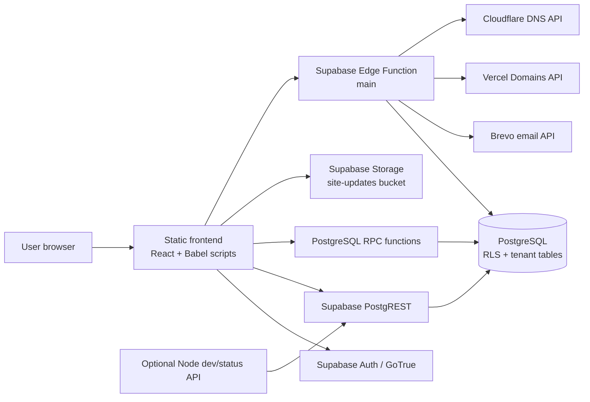

# Ops Central architecture, security, DevOps, and request-flow audit

**Audit date:** 2026-10-12
**Repository:** `UniMisk-Erp-Solutions/ops-central`
**Branch / commit:** `main` / `f5f4062426fdc59d5466aab0c67d73d954a006c0`
**Source examined:** the current working tree. It already contained uncommitted changes in `docs/client-requests.md`, `frontend/src/screens-client-requests.jsx`, and `frontend/package-lock.json` when this audit began. Those changes are not part of the audited commit. This phase updated this audit and its required index entry only; it did not modify application, schema, migration, server, or deployment files.

## Executive summary

Ops Central is a multi-organization ERP delivered as static files. React components and JSX are compiled in each visitor's browser by Babel Standalone. The browser signs in with Supabase Auth and uses the public Supabase client to read and write most business tables through PostgREST, database RPCs, and Storage. PostgreSQL RLS is the actual data boundary. The separate Node server is a small development/status API; the deployed Supabase Edge Function owns vendor RFQ email, public quote-link processing, and tenant-subdomain provisioning.

The repository has a tenant model based on organization memberships, active-organization context, organization-scoped policies, per-organization features and workflows, and composite organization keys for product/category/BOM master data. The hostname is used for branding and lookup; membership and database functions decide access. Two design limitations need attention in a multi-organization rollout: the base app role is stored on the global `users` profile rather than per organization, and offline cache recovery matches a user but does not verify the cached org ID. Application role checks are also mostly browser checks. The operational table policies generally authorize **any active member of the active organization** for all SQL operations. An authenticated user can bypass the UI and submit their own request to PostgREST. App roles such as Stores, Billing, Client Facing, and Purchase therefore do not provide server-enforced separation for ordinary transactional writes in the migrations reviewed.

The Edge Function uses a service-role key for direct database access. Its RFQ float and vendor quote endpoints do not verify an authenticated business caller before performing those privileged operations. The quote token serves as a bearer capability for quote access. In addition, quote-submit reports success without checking the database PATCH results, and its read/modify/write of JSON fields can lose concurrent changes.

Other confirmed reliability and integrity concerns include optimistic whole-row synchronization without a commit barrier, multi-table order conversion without a transaction, number generation without database uniqueness, no pagination in the initial table loader, and public, non-tenant-scoped Storage access for the `site-updates` bucket. These findings are source-based. No live requests, database policies, deployment state, firewall, backups, or runtime logs were inspected, so no claim is made that these conditions are active in the deployed instance.

**Finding counts:** 1 confirmed critical-severity finding, 5 confirmed high-severity findings, 11 confirmed medium-severity findings, 3 confirmed low-severity findings, and 4 suspected risks / unverified operational gaps. Severity is an audit prioritization, not evidence of a production exploit in a deployed environment.

## 1. Scope and audit rules

This Phase 1 review combines repository evidence with a narrowly scoped, read-only SSH availability check previously performed on 2026-10-09. The supplied SSH host (`192.168.23.15`) accepted the provided `olympus` login. That check queried Docker only for the repository-documented service ID `hws00sks44g8k04k8wccooco` and checked only its documented Coolify service directory. It found no matching database container (running or stopped) and the service directory was absent. Therefore no PostgreSQL connection or live database query was possible. No other Coolify service, project, database, or container was inspected. No SSH inspection scripts were run. No deployment, restart, migration, or external data write occurred; no SQL migration or application fix was made as part of this audit.

The attached guide and repository documentation were treated as descriptions to verify against source, not as proof that a deployment currently matches them. Secrets and key values are not reproduced here. The public Supabase anon key is present in the static frontend configuration; by design that key is not a secret and must remain protected by RLS.

“Confirmed” means the code or checked-in migration directly exhibits the behavior described. “Suspected / unverified” means repository evidence points to a concern that needs live deployment, configuration, or adversarial verification before it can be confirmed.

## 2. Repository and implementation overview

### Repository discovery

- `CLAUDE.md` is the repository working agreement. It directs readers to `docs/architecture.md` before JSX edits and says JSX runs in one browser global scope with no build step.
- There is no root `README.md` or `CONTRIBUTING.md` in the tracked file listing. Documentation lives under `docs/`, and `docs/INDEX.md` is its index.
- The source tree has `frontend/`, `backend/`, `supabase/functions/`, `supabase/migrations/`, `scripts/`, and `docs/`.
- The migration directory contains the sequence `001` through `039`, including tenancy, RLS, organization context, workflows, aliases, synchronization metadata, client requests, and billing changes; it also contains a separate `021` rollback script. Migration files describe intended state and do not prove which files are applied to a running database.
- The frontend package defines only `dev` and `start` scripts; there are no frontend lint, build, or test scripts. The repository has many Node-based UI checks under `scripts/uitest/`.
- The checked-in Vercel config serves the static frontend. No Docker Compose file, Supabase CLI project config, CI workflow, or infrastructure-as-code directory appears in the repository file listing. This does not prove those are absent from external deployment configuration.

### Framework and runtime

`frontend/index.html` loads React 18, ReactDOM, Babel Standalone, and Supabase JS from CDNs, then loads plain scripts and JSX scripts. There is no bundler or server rendering. Every JSX file shares the same global scope. `frontend/src/config.js` creates `window.OPC_SB` from runtime configuration.

The checked-in browser configuration contains a Supabase URL and public anon key. The browser persists the Supabase Auth session and auto-refreshes its token. Most table calls use `window.OPC_SB.from(...)`; RPC calls use `.rpc(...)`. The UI stores all operational data in one React store and mirrors it to localStorage as a recovery buffer.

The Node API in `backend/src/server.js` adapts Node requests to the Fetch API handler in `backend/src/handler.mjs`. That handler serves `/health` and `/api/status`; it does not implement the ERP workflow. `backend/src/lib/supabase.mjs` prefers `SUPABASE_SERVICE_ROLE_KEY` if set, otherwise uses anon keys.

`supabase/functions/main/index.ts` is the business-facing server code in this repository. It uses the Supabase service key to call PostgREST and contains `/float-rfq`, `/quote-load`, `/quote-submit`, and `/provision-subdomain`. `supabase/functions/main/handler.mjs` is shared by the Node dev API but only handles health/status paths. The Edge Function and Node handler are not a general server-side transaction layer for ERP writes.

No Realtime subscriptions were found in the frontend source. There is one Storage bucket migration, `site-updates`. No scheduled worker/queue/job implementation was found in the inspected repository paths.

### Current architecture diagram



The diagram shows code paths present in the repository. It does not assert which services are deployed, healthy, publicly reachable, or connected to the configured URLs on audit day.

### Component responsibility table

| Component | Responsibility found in source | Trust / enforcement boundary |
|---|---|---|
| `frontend/index.html` | Loads third-party runtime scripts and application scripts | Browser and CDN supply executable code; no bundling/build pipeline |
| `frontend/src/app.jsx` | Hash router, screen selection, client-side role route guard | UI only; a route guard is not an API authorization boundary |
| `frontend/src/permissions.jsx` | Built-in roles, capability checks, feature flags, workflow settings | Browser-side decisions; configurable via org config loaded into `window` |
| `frontend/src/store.jsx` | Auth session, organization context, state, table reads, write sync, local cache | Direct browser-to-Supabase access; RLS supplies database tenant gate |
| `frontend/src/screens-*.jsx` | Business forms, calculations, status actions, document generation | Mostly browser logic; most tables are persisted by direct client writes |
| `frontend/src/tenant-context.js` | Hostname-to-subdomain lookup and public branding resolution | Hostname is explicitly UX only; database membership is authoritative |
| Supabase PostgREST | Browser API over PostgreSQL tables | Auth JWT, grants, and RLS; no separate ERP API boundary for most writes |
| SQL RPCs | Organization context, admin/user operations, alias matching, config, tenancy | `SECURITY DEFINER` functions need careful per-function authorization review |
| Supabase Edge `main` | RFQ email, quote token reads/submissions, Vercel/Cloudflare provisioning | Service-role access; some routes lack caller authentication/authorization |
| Node API | Local API wrapper, health, legacy DB status query | Not the workflow backend; binds `0.0.0.0` by default |
| PostgreSQL | Authoritative tables, tenant policies, functions, JSON documents | RLS is the key tenant boundary; policy role granularity is insufficient for some duties |
| Supabase Storage | Public site-update attachments | Bucket policies do not bind objects to a tenant or owner |
| Vercel config/docs | Static frontend headers and deployment guidance | Actual deployment settings are outside the repository and were not checked |
| Server scripts/docs | SSH setup, migration, test, deployment, restart, and verification helpers | Privileged operational tools; none were executed for this audit |

### Trust boundaries

| Boundary | What crosses it | Controls present in repository | Audit observation |
|---|---|---|---|
| Browser ↔ Supabase Auth | Credentials, session, JWT | Supabase Auth client, profile lookup | Password verification is server-side through GoTrue; login and signup RPCs also exist |
| Browser ↔ PostgREST | Table reads/writes | Anon key + user JWT, grants, RLS | Most business mutations are direct client requests; role checks are not generally repeated in SQL policies |
| Browser ↔ SQL RPC | Tenant context, config, alias mapping, admin actions | `SECURITY DEFINER`, explicit membership/admin checks vary by function | Each function must be audited individually; function grants are broad to authenticated where needed |
| Browser ↔ Edge Function | RFQ payloads, quote tokens, admin provisioning | CORS allowlist; service-role secret on server | CORS is not authentication. RFQ and quote routes rely on input/token possession rather than verified user identity |
| Browser ↔ Storage | Site-update files | Bucket size/MIME constraints and Storage RLS | Public reads; any authenticated user can update/delete any object in bucket based on bucket ID alone |
| Edge Function ↔ external providers | Vendor mail, domain/TXT operations | Server-side credentials and some host/TXT checks | Multi-service operation is not transactional; partial success is possible |
| Local browser ↔ localStorage | Cached rows and organization/business state | User/organization cache stamps and recovery filtering | Cache is not encrypted and may hold customer, vendor, and financial data on the device |

## 3. Data and request flow

### Browser-to-server-to-database path

1. The browser loads static HTML/JS/JSX and initializes the Supabase client.
2. `StoreProvider` calls `auth.getSession()` and listens for Auth state changes.
3. After login, it reads the user's profile and calls `opc_my_context()` to retrieve active organization, organization branding, features, and context.
4. It loads each table in `LOADED_TABLES` with parallel `.from(table).select('*')` calls. Tenant filtering is expected to come from RLS; the browser does not add `organization_id` filters to these reads.
5. Screens run business validation and calculations in JavaScript. Mutations generally update React state first and call asynchronous table upserts/deletes in the background.
6. PostgreSQL RLS checks the active organization membership. Admin/config RPCs have function-specific checks.
7. The store writes state to localStorage. If DB loads failed for individual tables, the loader can leave the initial state for those tables and still mark the overall application loaded.

### Business flow

| Step | Typical actor / screen | Main data | Current handling and status | Failure / audit behavior |
|---|---|---|---|---|
| Client requirement / item request | Client Facing / Item Requests | `client_requests` | Draft → Sent → Converted/Cancelled. Request screen collects customer, text, quantity, notes; Purchase performs matching and SO creation. | The current working tree has a local change that waits for create/send writes; the audited commit does not include that change. Detail send and convert remain optimistic in source. |
| Sourcing / inquiry | Sales, Pre-sales, Purchase / Sourcing | `sourcings`, `item_aliases`, customers, products | Creates an inquiry, allocates vendor/item/quantity, records quoted prices and sourcing status. Some flows skip this step. | Local state and multiple table writes; no generic transaction boundary. |
| Vendor comparison / RFQ | Purchase / RFQ Comparison | `rfqs`, `sourcings` | Browser calls Edge `/float-rfq`; Edge stores vendor tokens and emails vendors. Vendor quote page calls `/quote-load` and `/quote-submit`. | Edge writes RFQ before email; email send results can be partial. Quote-submit ignores REST PATCH results. |
| Sales Order | Sales / Sales Orders, or Purchase conversion from request | `sales_orders`, request and sourcing linkage | Created and edited in browser. Status, totals, line JSON, and document numbers are largely client-calculated. | Upsert is asynchronous; uniqueness and business transition rules are not generally database constraints. |
| Vendor PO | Purchase / Vendor POs | `vendor_pos`, related SO/sourcing JSON | Created/edited by role-controlled screens and direct table sync. May combine SOs and vendors depending on workflow. | Related SO/PO writes can partially succeed; no observed transactional conversion endpoint. |
| Receipt / GRN | Stores or Purchase depending on workflow / GRN | `grns`, `vendor_pos`, SO line JSON, pool | Workflow profile chooses requester/approver role labels and direction; client code updates quantities/statuses. | Status/quantity checks are client-side; RLS does not distinguish Stores from Billing/Purchase for table writes. |
| Virtual Godown / stock | Stores / Virtual Godown | SO JSON, `pool`, transfer rows | Quantities derive from receipts, allocations, dispatches, and transfers. `pool` writes use explicit calls. | Multiple writes and stale state can produce divergence; some store helpers log failures and still return success. |
| Dispatch / transfer | Stores Out / SCM Tracking; PM approval for transfers | `outward_dispatches`, SO JSON, `transfer_requests`, pool | Dispatch and transfer status changes are browser actions; workflow settings affect steps. | No SQL-level role enforcement for operational tables. Whole-document updates can race. |
| Invoice / e-Way bill | Billing / Invoices | `sales_orders` JSON and related invoice fields | Tax and invoice amounts are calculated in the client; invoice data is held in SO JSON rather than a dedicated invoice table for customer invoices. | Financial calculations/statuses are client-trusted; separate operations can partially write. Government integrations are not proven by source. |
| Collection / payment | Collections / Collections | `payments`, SO/invoice JSON | Browser records amount/date/mode/reference and updates display/status values. | No observed server-side payment reconciliation transaction or role-specific RLS policy. |
| Notifications | All roles / notification drawer | `notifications` | Browser adds role-targeted or user-targeted rows; UI filters by role/user. | SQL read/write policy is tenant member scope; `role` and `user_id` values are row data and may be forged by a member. |
| Audit history | Admin / Audit Log | `audit` | Browser `mutate()` appends audit entries and syncs them like other rows. | No immutable DB trigger or actor derivation for generic rows; direct member writes can forge or alter audit rows. |
| Reports | Dashboard / reports within screens | Many operational tables | Calculated from data already loaded in browser. | Accuracy depends on completeness of initial unpaginated table reads and current state. |

### Main workflow sequence

```mermaid
sequenceDiagram
  participant C as Client Facing browser
  participant P as Purchase browser
  participant DB as Supabase PostgREST / PostgreSQL
  participant E as Supabase Edge Function
  participant V as Vendor quote page
  participant Mail as Brevo

  C->>DB: select customers / create client_requests Draft
  C->>DB: create Purchase notification and mark Sent
  P->>DB: load request + products; opc_alias_resolve_bulk
  P->>DB: insert new products/categories/BOMs as needed
  P->>DB: create Sales Order + sourcing + set request Converted
  P->>DB: opc_alias_set_bulk (best effort)
  P->>E: POST /float-rfq with inquiry, vendor, item data
  E->>DB: read/update RFQ and parent org
  E->>Mail: send vendor quote links
  V->>E: GET /quote-load with bearer token
  V->>E: POST /quote-submit with prices and terms
  E->>DB: PATCH RFQ vendor JSON; patch sourcing prices
  P->>DB: create Vendor PO, GRN, dispatch, invoice, payment through browser mutations
```

The Edge mail flow and the regular ERP flow are separate. The latter mostly bypasses the Node API and directly writes table rows from the browser.

## 4. Multi-organization model

### Organization resolution

- Auth identity is the Supabase Auth UUID (`auth.uid()`), mirrored by a `public.users` profile.
- `organization_memberships` joins a user to one or more organizations and stores an `admin`/`member` membership role.
- `user_active_org` stores an explicit active organization. `active_org_id()` resolves that setting or falls back to the first active membership ordered by `created_at`.
- `opc_set_active_org(uuid)` checks membership, or allows a platform master admin, before storing the selection.
- `is_org_member(org_id)` in migration 022 requires the row's organization to equal the active org and checks membership (master admin is an exception within that active-org scope).
- Table defaults stamp organization IDs from `active_org_id()`; browser host/subdomain and localStorage are not the source of truth.
- `tenant-context.js` calls `get_organization_by_subdomain` for public branding before login. The function returns organization metadata only. The browser code comments say host lookup is UX only.
- The frontend calls `opc_my_context()` on identity change and on focus/online for feature/workflow refresh. The repository search found no frontend call to `opc_set_active_org()` and no visible active-organization switcher path. Org switching is available as a SQL RPC, but browser lifecycle behavior for an externally changed active org is not covered by a test in this audit.

### Organization-specific role model and cache boundary

- The membership table's role is the membership administrator/member flag. The app's named role (Sales, Purchase, Stores, etc.) is returned from `public.users.role`, a global profile field; `opc_org_users()` scopes which profiles are returned to the active organization but does not make the role value organization-specific. Per-org config can override capabilities/navigation, but the base named role assignment is still global. This matters when one login belongs to multiple organizations and those organizations expect different base roles.
- `store.jsx` persists app state with `__uid` and `__orgId`. At boot, cached rows are held aside while a backend is configured, and a different user causes rows to be cleared. However, when reconciling `__cached` after table loads, recovery checks `__cached.__uid === realUserId` but does not also check `__cached.__orgId === active_org_id`. If the same login previously cached Org A rows and later opens under Org B, rows absent from B can be merged into the visible state as local-only and queued for recovery. Their Org A `organization_id` should make RLS reject an attempted cross-org write; this does not prevent stale Org A data from appearing in the Org B UI before/while recovery fails. This is a same-login, multi-org cache-context issue, not evidence that a user outside Org A can access its data.

### Isolation coverage

| Data area | Organization ownership | RLS / key model in migrations | Audit note |
|---|---|---|---|
| `organizations` | Organization row ID | RLS; users see membership orgs, master admins can list; writes master-admin only | Platform boundary uses dedicated helpers |
| `organization_memberships` | `organization_id`, `user_id` | RLS; user can read self, org admin can read/write org memberships | Membership role is `admin`/`member`, not the app role |
| `master_admin_memberships` | Global platform identity | RLS, no client grants/policies for writes; SQL/security-definer path | High-privilege global table |
| `organization_features`, `organization_settings`, `user_active_org` | `organization_id` or `user_id` | RLS and admin/self policies; setter RPC validates membership | Feature and workflow config is per organization |
| Operational tables created by migration 002 and scoped in 019/021 | `organization_id` | RLS `FOR ALL` using `is_org_member` / `WITH CHECK` | Tenant boundary exists, but app-role authority is not expressed in the table policy |
| `outward_dispatches` | `organization_id` | Created later in 026 with explicit tenant RLS and active-org default | Scoped despite not being part of the original 021 loop |
| `item_aliases` | `organization_id` | Explicit RLS policy in 026; helper RPCs filter active org | Product/customer/vendor cross-reference columns are not consistently foreign-key constrained |
| `client_requests` | `organization_id` | Non-null org FK/default, RLS member policy, org/status/customer indexes | `customer_id` and `converted_so_id` are text with no same-org FK in the table definition |
| `products`, `categories`, `boms` | `organization_id` | RLS; migration 023 adds composite PKs and same-org BOM→category FK | Good same-org keys for these entities; not a general cross-reference pattern |
| `users` | Membership join; no org column | `shares_org_with` profile read; special admin/master write policy; scoped RPCs for app roster | `users.role` is global per login, while membership can be many-to-many |
| `site-updates` storage objects | No tenant column/path policy | Public read and authenticated bucket-wide insert/update/delete | Cross-organization confidentiality and object integrity are not protected by tenant policy |
| Browser recovery cache | `localStorage` state stamped with user and org metadata | Backend-enabled boot buffers cache; recovery checks the user stamp but not the org stamp | Same-user organization context can display stale rows; RLS should reject stale-org writes |

Tenant RLS prevents ordinary users from reading a row whose organization is outside their active-org membership. A set of related IDs in a JSON field or text reference does not itself prove that the referenced row belongs to the same organization. Aside from the product/category/BOM key relationship in migration 023, the schema uses few tenant-aware foreign keys between business records.

### Roles and enforcement

Built-in app roles in `frontend/src/permissions.jsx` are **Org Admin, Sales, Pre-sales, Project Manager, Purchase, Stores, Managing Director, Billing, Collections, Stores In, Stores Out, Client Facing, Supervisor**, plus a safe unknown-role fallback. A config object `window.__opcPerms` can replace role-specific navigation and capability values. `canAccess()` and `canDo()` execute in the browser. Workflow settings come from profiles/overrides returned by `opc_my_context()`; feature flags and workflow keys gate routes in the browser.

| App role | Main screens in built-in nav | Notable client capability | Database enforcement found |
|---|---|---|---|
| Org Admin | Most screens, settings, onboarding, audit | `all` | Some admin RPCs/config/profile policies use admin/master checks; ordinary operational tables still use membership policy |
| Sales | Dashboard, inquiry, SO, customers, products | Create SO, create sourcing, edit own draft | No app-role-specific write policy on operational rows |
| Pre-sales | Inquiry, SO/customer/product/vendor views | Create/do sourcing, choose vendors, view cost | Same tenant-member policy for direct writes |
| Project Manager | SO, approval inbox, godown, transfer, RFQ, invoice views | Approve/edit SO, authorize dispatch, initiate transfer | Approval gates are primarily client code; no generic DB role gate |
| Purchase | Sourcing, SO view, RFQ, PO, GRN, product/vendor, request | Create RFQ/PO; convert request | UI checks; tenant membership RLS permits direct table writes independent of role |
| Stores / Stores In | GRN, godown, pool, products | Receive/reconcile | UI/workflow checks; no role-specific operational RLS |
| Stores Out | SO view, godown, SCM, pool, products | Dispatch | UI check; no role-specific operational RLS |
| Billing | SO, 3-way match, invoice, PO view | Match/raise invoice/e-Way bill | UI check; no role-specific operational RLS |
| Managing Director | Approval inbox, SO/procurement/invoice/collections/audit views | Approve all, view cost | UI check; no role-specific operational RLS |
| Collections | Collections, customers, invoices | Log follow-up | UI check; no role-specific operational RLS |
| Client Facing | Item Requests and SCM | Create request; view customer/product | UI/workflow check; direct member writes remain possible under table policies |
| Supervisor | Dashboard, inquiry, SO/godown | Implementation supervision | UI filters assigned sites; DB policy remains tenant membership |

The table describes built-in UI configuration, not a guarantee that a deployed org has identical overrides. A per-org `can` override affects browser behavior, not Postgres authorization. The membership role used by `is_org_admin` is distinct from the app role stored on `public.users`; the latter is global per login in the reviewed schema.

## 5. Module inventory

| Module | Main screen/source | Main tables or records | Main actions | Organization scope | Backend/database enforcement and risk |
|---|---|---|---|---|---|
| Dashboard / reports | `screens-dashboard.jsx` | SOs, PO, GRN, dispatch, invoice, payment | Summaries, status/value filters | Uses loaded tenant rows | Browser calculations; unpaginated loader may make reports incomplete at scale |
| Tasks / inbox | `permissions.jsx`, `screens-dashboard.jsx` / app | Usually same records as workflow tasks | Approve/reject/receive/dispatch tasks | Tenant loaded state | Task creation and action are client code; direct write RLS is broad |
| Item/client requests | `screens-client-requests.jsx` | `client_requests`, notifications, SO/sourcing and catalogue | Draft, send, match/create, convert, cancel/read SO | Request row tenant policy | Browser role checks; request creation partly direct; conversion is multi-write |
| Sourcing / inquiries | `screens-sourcing.jsx` | `sourcings`, customers, products, aliases | Create inquiry, vendor allocation, prices, convert | Tenant policies | Most workflow logic is client; no transaction around linked records |
| Sales Orders / import | `screens-so.jsx`, `screens-import.jsx` | `sales_orders`, customers, products, categories, BOMs | Create/edit, import, pricing, approval/status | Tenant policies; master data composite IDs | Client owns calculations, status, and line JSON; role-specific DB policy absent |
| Customers | `screens-masters.jsx` | `customers` | Create/edit/customer ledger | Tenant policies | Most access controlled by UI; text IDs and foreign refs lack comprehensive constraints |
| Vendors | `screens-masters.jsx` | `vendors` | Create/edit vendor | Tenant policies | Vendor fields/visibility capability are browser decisions |
| Virtual Godown / stock | `screens-godown.jsx` | SO line JSON, `pool`, GRN, dispatch, transfers | Availability, reserve/consume, receive reconciliation | Tenant rows; pool identity | Quantities/statuses are calculated in client; multiple writes may diverge |
| SCM tracking / dispatch | `screens-scm.jsx` | `outward_dispatches`, SO/PO JSON | In-transit and dispatch tracking/challan | Explicit dispatch tenant policy | Client controls dispatch payload/status; no DB role separation |
| Cross-SO transfers | `screens-godown.jsx` | `transfer_requests`, pool/SO JSON | Request, approve, move stock | Tenant policy | Transfer approval is UI task flow; not a transaction spanning all records |
| RFQ comparison / vendor replies | `screens-procurement.jsx`, `quote.html`, Edge `main` | `rfqs`, `sourcings` | Float, re-float, quote submit, compare/select | Edge stamps org from parent row | Service-key endpoint caller auth is a high-risk gap; quote writes can race/fail silently |
| Vendor POs | `screens-procurement.jsx` | `vendor_pos`, SO/sourcing | Create, edit, approve, combine, tax | Tenant policy | Amount/tax/approval checks are primarily in browser; not DB role-bound |
| GRN / three-way match | `screens-procurement.jsx` | `grns`, `vendor_pos`, `vendor_invoices` | Receipt, acceptance, reconciliation | Tenant policy | Role/workflow guards in client; financial/quantity invariants lack transaction enforcement |
| Invoices / e-Way bills | `screens-billing.jsx` | `sales_orders` JSON/invoice columns, vendor invoice table | Tax invoice, partial/final billing, e-way fields | Tenant policy on SO/vendor invoices | Customer invoice totals and status are client-calculated; integrations not verified |
| Collections / payments | `screens-billing.jsx` | `payments`, SO invoice state | Add collection/payment | Tenant policy | Client-controlled values; no observed payment ledger transaction or server validation |
| Products/categories/BOM | `screens-masters.jsx`, SO/import flows | `products`, `categories`, `boms` | Catalogue CRUD and recipes | RLS plus composite keys and BOM/category FK | These keys support tenant duplication; many BOM component product refs remain JSON IDs |
| Item mapping | `screens-mapping.jsx`, alias RPCs | `item_aliases`, products | Resolve and learn names/codes | RPC filters active org | SQL functions use active-org filters; referential constraints for product/party IDs should be verified |
| Customisation / users | `screens-config.jsx`, store, `public.config`, `users` | Config JSON, profiles, memberships | Role/permission/workflow settings, user operations | Config and user RPCs have special rules | Role configuration is browser-enforced; user role is global by login |
| Platform organizations | `screens-platform.jsx`, platform RPCs, Edge | Organizations, memberships, features, subdomains | Create org, assign users, enable features, provision host | Master-admin-only RPCs/policies | Dedicated checks exist; Edge domain provisioning has non-transactional external steps |
| Onboarding | `screens-config.jsx`, app | Organization/config/master data | Guided setup | Org config | UI flow plus server RPC for organization creation; test live behavior separately |
| Notifications | `shell.jsx`, store | `notifications` | Add/read/dismiss/view | Tenant RLS, in-row role/user selector | Delivery and audience are browser-authored row properties; not a server dispatcher |
| Audit log | `screens-config.jsx` / store | `audit` | View action history | Tenant RLS | Generic audit rows are client-created/editable; not immutable or server-stamped |
| Supervisor updates/files | `screens-godown.jsx`, Storage | SO `extra` JSON, `site-updates` objects | Add daily progress and attachments | DB records tenant-scoped; bucket objects are not | Public file reads and bucket-wide authenticated modification are confirmed |

## 6. Database and backend inventory

### Tables identified in migrations

| Table(s) | Purpose / shape | Tenant and integrity notes |
|---|---|---|
| `organizations`, `organization_memberships`, `master_admin_memberships` | Organization registry, user membership, platform administrators | Membership is the core boundary; master admins are global privileged identities |
| `organization_features`, `organization_settings`, `user_active_org`, `reserved_subdomains` | Feature toggles, workflow/config context, active org, reserved hostnames | RLS policies and helper RPCs; app context follows active org |
| `config`, `users` | Per-org configuration JSON; global login profiles | Config admin write policy; user roster scoped through membership functions and share-org logic |
| `customers`, `vendors`, `products`, `categories`, `boms`, `item_aliases` | Master records and alias map | Master tables have org IDs; products/categories/BOM have composite keys after 023; aliases use tenant unique indexes |
| `sales_orders`, `sourcings`, `rfqs`, `vendor_pos`, `grns`, `vendor_invoices`, `payments` | Main order/procurement/billing records | Most details are JSONB arrays/maps; no general row version column or database workflow transaction observed |
| `pool`, `transfer_requests`, `outward_dispatches` | Surplus stock, cross-order transfer, dispatch history | Tenant RLS; numeric and relationship rules mainly live in client code |
| `client_requests` | Client request with status, JSON items, notes, linkage | 036 has tenant RLS; no status CHECK, customer FK, or converted SO FK in its declaration |
| `notifications`, `audit` | Role/user target and action history | RLS tenant member scope; notification audience and audit actor are client-supplied fields |
| `storage.buckets`, `storage.objects` | Supervisor evidence files | One public bucket policy, not organization-aware |

Most transactional references are plain text IDs or JSONB rather than tenant-aware foreign keys. The schema's initial `002` migration demonstrates the document model: SO lines, PO items, GRN items, RFQ vendors/quotes, transfers, and notification records are stored as JSON or standalone rows with few SQL relationships.

### RPC and server inventory

| Endpoint/function | Caller and purpose | Source-level guard / risk |
|---|---|---|
| Supabase Auth `signInWithPassword` | Browser login | GoTrue handles credential validation; profile is looked up after login |
| `opc_my_context`, `opc_my_organizations`, `opc_org_users`, `opc_admin_all_users` | Tenant context and role roster | Security-definer functions; active-org or master-admin logic is present in inspected migrations |
| `opc_set_active_org` | Set active org | Validates org existence and membership or master-admin status; frontend currently has no discovered caller |
| `opc_get_config`, `opc_save_config`, `opc_set_org_feature`, `opc_create_organization` | Config/features/onboarding | Explicit active-org/admin/master-admin checks in SQL source |
| `opc_create_user`, `opc_delete_user`, `opc_admin_*` | User administration | Function-specific admin/master checks; review all grants in the deployed DB against migration history |
| `opc_sync_columns` | Return actual table columns for client write filtering | Security definer and authenticated grant; metadata only, but security-definer grants should stay deliberate |
| `opc_alias_*` | Item-name mapping | Functions filter by active organization and validate basic scope/product input; product existence/same-org relationship should be constrained |
| `/float-rfq` Edge route | Browser starts or re-floats vendor requests | Service-key database access; no caller JWT/role/org authorization check in this route |
| `/quote-load` Edge route | Vendor obtains quote using token | Token is the bearer access control; exact token comparison; no expiry/rate limiting observed |
| `/quote-submit` Edge route | Vendor submits quote prices/terms | Token checked; incoming price values are weakly normalized; REST update errors ignored before `{ok:true}` response |
| `/provision-subdomain` Edge route | Platform admin adds tenant hostname | Checks caller JWT with `is_master_admin`; external Vercel/Cloudflare operations are staged and non-atomic |
| Node `/health` and `/api/status` | Health/status | CORS `*`; status uses configured service-role key if present and queries legacy `org_settings`; no caller authentication |

No generic ERP CRUD API or job/queue worker appears in the checked-in server code.

## 7. Request inventory and validation

| Request/action | Caller | Method / destination | Auth and org scope | Data / validation | Error and risk |
|---|---|---|---|---|---|
| Initial table load | `StoreProvider` | Parallel GET via `.from(table).select('*')` | Supabase session JWT; RLS is expected to scope active org | No explicit page/range or select projection | Per-table errors are skipped; app can mark loaded with incomplete arrays; no pagination |
| Normal transactional mutation | Screen → `mutate()` → `__syncTables()` | PostgREST upsert/delete | Supabase session JWT; row `organization_id` defaults and RLS | In-memory row filtered using `opc_sync_columns`; validation mostly UI | Fire-and-forget; status success can precede DB result; RLS checks tenant, not app role |
| Client request create/send | Request screen | PostgREST upsert `client_requests` and `notifications` | Auth session; active-org default and RLS | UI validates customer/items/qty; DB JSON has no schema/check constraints | Current worktree waits for saves; submitted commit did not. No idempotency on request number |
| Request conversion | Purchase screen | Direct product/category/BOM writes then normal store sync of SO/sourcing/request/notifs | Auth session; RLS tenant | Item match decision and SO lines client-generated | Multiple independent operations; partial records possible; only UI gates role/status |
| Config save | Settings screen/store | `opc_save_config` RPC, fallback direct config upsert | Auth session; active-org/admin checks on function/table | Whole config JSON | Local state is updated before confirmed DB result; fallback behavior needs deployed-version validation |
| Alias matching | Item mapping/request screen | `opc_alias_resolve_bulk` RPC | Auth session; SQL uses active org | Row names/codes submitted by browser | Matching results are advisory; direct request values should not be trusted as authorization |
| Alias learn-back | Item mapping/request conversion | `opc_alias_set_bulk` RPC | Auth session; SQL functions scope org | Product/party and alias fields | Failure is best effort in request conversion; cross-reference FK coverage is limited |
| Float RFQ | Purchase screen → Edge | POST `/functions/v1/main/float-rfq` | Static anon API key; route does not verify JWT/role. CORS is not auth. | Body controls source ID, vendors/emails, item list, locks, labels | Service-role writes and email side effects; no rate limit/idempotency; partial mail accepted |
| Load quote | Vendor page → Edge | GET `/quote-load?t=...` | Public endpoint + bearer token | Query token | No expiry or rate limit found; token access intentionally grants quote data |
| Submit quote | Vendor page → Edge | POST `/quote-submit` | Public endpoint + bearer token | Price/terms JSON; numeric coercion but no comprehensive range/finite/allowed-product checks | DB PATCH response ignored; success can be false; concurrent JSON updates can overwrite |
| Provision tenant subdomain | Platform UI → Edge | POST `/provision-subdomain` | Caller JWT replayed to `is_master_admin()` | Host regex and `_vercel` TXT name constraint | External steps can partially complete; retries are required; provider/runtime credentials unverified |
| Storage upload/read | Supervisor UI | Supabase Storage API | Auth required for write, public read | 25 MB/MIME configuration in bucket migration | Any auth user can update/delete bucket objects; no tenant path policy |
| Node status | Any HTTP client | GET `/api/status` | No app auth; service key may back Supabase client | Counts `org_settings` rows | Exposes count/error details and tests a legacy schema, not end-to-end readiness |

Across PostgREST requests, browser-supplied data includes business values such as statuses, prices, quantities, audit actor IDs, notification audience, and cross-record IDs. RLS protects tenant rows but does not validate these fields or enforce the screens' app-role capability matrix.

### Source call-site inventory

This is a static inventory of request builders found in the working tree. It is not a browser Network capture and it does not prove that each deployed route is reachable. Table reads for regular app screens generally share the loader; transactional writes generally share `mutate()` rather than having a unique HTTP call at every button.

| Source call site | Supabase/HTTP operation | Data or purpose | Source-level outcome handling |
|---|---|---|---|
| `screens-auth.jsx` login check | RPC `opc_admin_exists` | Select login vs first-admin signup mode | Error is swallowed; defaults to login |
| `store.jsx` login | Auth `signInWithPassword`, then `users.select(...).eq(id).maybeSingle()` | Establish session and load current profile | Handles auth error; signs out if no profile |
| `store.jsx` initial tenant context | RPC `opc_my_context` | Org ID, branding, features, workflow | Errors fall back to empty/not-ready-like context without explicit error banner |
| `store.jsx` focus/online refresh | RPC `opc_my_context` | Refresh features/workflow | Errors are silently ignored; does not reload table data |
| `store.jsx` config boot | RPC `opc_get_config`; fallback `config.select('data').eq('id','singleton')` | Load per-org configuration | RPC falls back on error; direct legacy singleton fallback may not align with org-scoped schema in some installs |
| `store.jsx` user roster | RPC `opc_org_users` | Active-org user profiles | Errors logged, previous roster can remain |
| `store.jsx` business-data boot | Parallel `select('*')` for `products`, `categories`, `boms`, `customers`, `vendors`, `sales_orders`, `vendor_pos`, `grns`, `vendor_invoices`, `payments`, `pool`, `rfqs`, `sourcings`, `transfer_requests`, `notifications`, `audit`, `outward_dispatches`, `client_requests` | Initial tenant state | Per-table errors are skipped; no pagination |
| `store.jsx` sync metadata | RPC `opc_sync_columns` | Column names used to filter outgoing rows | If unavailable, sends unfiltered rows |
| `store.jsx` generic mutation sync | Per-table upsert on changed rows; delete IDs removed from arrays | Operational tables in `SYNCED_TABLES` | Errors reported asynchronously; no rollback/await in `mutate()` |
| `store.jsx` sync retry | Reload sync columns, then generic upsert of every current row | Retry local changes | `__syncTables()` is not awaited; completion can precede writes |
| `store.jsx` offline recovery | Select-local merge then per-row PostgREST upsert | Recover local-only rows missing in DB; notifications excluded | Per-row error is reported, but loading is not blocked |
| `store.jsx` config save | RPC `opc_save_config`; fallback `config.upsert` | Save merged config blob | Returns error result, but React config state updates before DB acknowledgment |
| `store.jsx` signup | RPC `opc_signup_admin`, then Auth `signInWithPassword` | Create initial account/session | RPC/auth errors returned to form |
| `store.jsx` create user | RPC `opc_create_user` | Create auth user/profile/membership | Errors returned; actual RPC has a global `is_admin()` guard in migration 021 |
| `store.jsx` set user active | `users.update({active}).eq(id)` | Enable/disable profile | UI state changes before request; error only logged |
| `store.jsx` remove user | RPC `opc_delete_user` | Delete user identity/profile | Error returned; legacy function has the cross-org authorization issue in SEC-00 |
| `store.jsx` add vendor/customer | `vendors.insert(...).select().single()` / `customers.insert(...).select().single()` | Create master records | Errors returned; successful response is added to state |
| `store.jsx` surplus pool | `pool.insert(...).select()`, then `pool.update` or `pool.delete` by ID | Add/consume surplus | Add error returned; consume errors logged while helper returns `{ok:true}` |
| `screens-config.jsx` organization context/features | RPCs `opc_my_context`, `opc_set_org_feature` | Read active org/features and toggle org features | UI error behavior varies; SQL function has admin check |
| `screens-mapping.jsx` alias management | RPCs `opc_alias_map`, `opc_alias_set` | Read/learn customer/vendor aliases | Functions filter by active org; UI reports RPC errors |
| `screens-import.jsx` and `screens-client-requests.jsx` matching | RPC `opc_alias_resolve_bulk` | Resolve customer/vendor names against catalogue | Request matching catches errors and continues with unmatched items |
| `screens-client-requests.jsx` create/send | `client_requests.upsert`, `notifications.upsert`, request status upsert; best-effort deletes on error | Draft/send notification and status | Current working tree awaits writes; this is an uncommitted local change and not in audited HEAD |
| `screens-client-requests.jsx` convert | `products.insert`, `categories.insert`, `boms.insert`; then generic mutation sync; RPC `opc_alias_set_bulk` | Create catalog records, SO, sourcing, converted request, notifications, learn aliases | Some errors halt before conversion; BOM/alias failures can be best effort; overall multi-row operation is not atomic |
| `screens-sourcing.jsx` float/re-float | POST Edge `/float-rfq` with public anon key and JSON vendor/item payload | RFQ storage and vendor email | UI sees HTTP response; Edge route does not authenticate actor |
| `frontend/quote.html` vendor open | GET Edge `/quote-load?t=...` with public anon key | Retrieve vendor-specific quote content | Errors displayed; token is bearer access |
| `frontend/quote.html` quote submit | POST Edge `/quote-submit` with token/prices/terms | Submit vendor quote | Vendor page handles response, but Edge currently returns success without checking PATCH response |
| `screens-platform.jsx` platform calls | RPC family: `opc_admin_list_organizations`, `opc_admin_set_feature`, `opc_admin_set_subdomain`, `opc_admin_set_billing`, `opc_admin_list_workflow_profiles`, `opc_admin_set_workflow_profile`, `opc_admin_set_workflow_key`, `opc_admin_get_org_config`, `opc_admin_set_org_config`, `opc_admin_all_users`, `opc_admin_create_org`, `opc_admin_org_members`, `opc_admin_create_user`, `opc_admin_set_user_email`, `opc_admin_set_user_password`, `opc_admin_set_user_active` | Platform org, feature, workflow, config, and user management | Most SQL functions explicitly check `is_master_admin()`; audit deployed definitions and grants |
| `screens-platform.jsx` domain provision | POST Edge `/provision-subdomain` with session JWT in `x-caller-jwt` | Vercel domain and Cloudflare TXT provisioning | Edge checks master-admin status; external operations can partially complete |
| `tenant-context.js` pre-login branding | POST PostgREST RPC `get_organization_by_subdomain` using anon key | Public branding lookup by hostname | Errors become a tenant-context error state; hostname is not authorization |
| Edge `main` service calls | Supabase REST GET/POST/PATCH using service-role key; Brevo email; Vercel/Cloudflare APIs | RFQ, quote storage, and domain operations | Float checks RFQ upsert but not all read/email outcomes; quote-submit ignores PATCH outcomes |
| Node API | `/health`, `/api/status`; status queries `org_settings` using configured Supabase key | Process/database status | No caller auth; status path targets legacy table and is not end-to-end health |

The `screens-platform.jsx` RPC family was enumerated from call sites. This audit inspected representative SQL guard patterns and the user-management functions relevant to confirmed findings; it did not execute every RPC or exhaustively prove every grant against a live schema.

### Item Request browser-to-database trace

This trace describes the current working-tree code, including the pre-existing local request-save changes noted at the top of this audit. It is static source analysis; there was no browser Network capture or live DB query.

| Step / component | Request and payload | Auth and organization scope | Response and error handling |
|---|---|---|---|
| Load / `StoreProvider` in `store.jsx` | Auth session from `auth.getSession()`; `opc_my_context()` RPC; parallel `select('*')` of `client_requests`, customers and other `LOADED_TABLES`; user roster via `opc_org_users()` | Supabase JS attaches session JWT. Context resolves `active_org_id()` from membership on the server. `client_requests` read is expected to be restricted by RLS. | Auth failure signs out or leaves context incomplete; per-table loader errors are skipped and app can continue with incomplete arrays. No explicit organization filter is added to table read. |
| New Draft / `ClientRequestNew.save(false)` | `client_requests.upsert(initial, {onConflict:'id'})`; row has client-generated ID/request number, customer ID, status Draft, JSON item list `{id,text,qty,note,product_id,matched_by}`, notes, `created_by`, timestamps/link fields. `organization_id` is omitted. | Browser session JWT. Migration 036 grants authenticated CRUD and defaults `organization_id` from `active_org_id()`; membership RLS checks tenant. `created_by` and business fields remain client-supplied. | The current working tree awaits the upsert and checks `error` before local `mutate`, toast, or navigation. Failure is shown in the form. With no configured backend it supports local/demo mode; configured-but-unavailable client fails closed. |
| Send on creation / `ClientRequestNew.save(true)` | Upsert request first as Draft; upsert one `notifications` row targeted by `role: 'Purchase'`; upsert request again as Sent with `sent_at`; then update local state. | Same session and active-org defaults/RLS for both tables. Notification recipient role and text are browser-authored. | Each response error is checked. Catch attempts to delete notification and request, but cleanup is best effort; cleanup failure can leave a Draft and/or notification. No idempotency key or unique constraint on request number was found. |
| Send an existing Draft / `ClientRequestDetail.send()` | `mutate()` changes request to Sent and prepends a Purchase notification. | Same session; generic store sync uses PostgREST upserts with active-org default/RLS. | Toast is shown immediately; `mutate()` does not await or return the per-table upsert results. A failed write can therefore look successful until the asynchronous sync-error banner appears. This is distinct from the new-request send path above. |
| Match / `matchRequestItems()` | RPC `opc_alias_resolve_bulk` with customer scope, customer ID and one row per request item. | Session JWT; SQL matching uses server-side active organization. | Errors are caught and items remain unmatched for manual choice. Returned product IDs are suggestions; conversion still trusts browser selection. |
| Convert / `ClientRequestDetail.convert()` | Direct `products.insert` and `categories.insert` for new catalogue rows; best-effort `boms.insert`; then `mutate()` adds a Draft SO, linked Sourcing row, request status `Converted` + `converted_so_id`, Purchase/requester notifications; finally best-effort `opc_alias_set_bulk`. | Session JWT. Inserts omit `organization_id`, relying on DB defaults and tenant RLS. SO lines and cross-record IDs are JSON/client-built; no single transaction spans these writes. | Product/category insert errors stop conversion and toast. BOM and alias errors do not stop it. Generic `mutate()` sync is asynchronous; success toast/navigation can precede SO/sourcing/request/notification commit. No converter-level idempotency/transaction was found. |

```mermaid
sequenceDiagram
  participant C as Client Facing browser
  participant Store as StoreProvider / Supabase JS
  participant API as PostgREST / RPC
  participant DB as PostgreSQL + RLS
  participant P as Purchase browser
  C->>Store: save Draft or Send request
  Store->>API: upsert client_requests (organization_id omitted)
  API->>DB: active-org default + tenant RLS
  DB-->>API: row result or error
  opt Send new request
    Store->>API: upsert notifications (role=Purchase)
    API->>DB: active-org default + tenant RLS
    DB-->>API: result or error
    Store->>API: upsert client_requests status=Sent
  end
  API-->>C: Supabase {data,error}; current new-form path checks errors
  P->>API: load request and call opc_alias_resolve_bulk
  API->>DB: active-org scoped match
  DB-->>P: suggestions or error
  P->>API: insert products/categories; best-effort insert BOMs
  P->>Store: mutate SO + sourcing + Converted request + notifications
  Store->>API: asynchronous independent table upserts
  API->>DB: RLS and row writes; no shared transaction
  DB-->>Store: per-write result; sync errors reported asynchronously
  P->>API: opc_alias_set_bulk (best effort)
```

## 8. Browser versus server responsibilities

| Operation | Current location | Security / reliability impact | Recommended future enforcement | Priority |
|---|---|---|---|---|
| Organization lookup by hostname | Browser calls public RPC | Branding input can be tampered with; should not authorize data | Keep as UX; derive actual org from authenticated membership server-side | Low |
| Auth identity/session | Supabase Auth in browser | Correct separation of password from app; every request still needs DB policy | Keep Auth; derive actor from JWT for all privileged writes | High |
| App role and screen capabilities | `permissions.jsx`, DB config loaded into browser | Bypassable by direct HTTP/PostgREST | Enforce action/role in RPC/API or database policies as defense-in-depth | High |
| Item/quantity validation | Screens | Direct caller bypasses UI | Shared schema validation at API/DB boundary; database numeric/status constraints | High |
| Document numbers | `utils.jsx` / browser state | Concurrent users can calculate same next number | Database sequence/transaction with unique constraint and retry semantics | Medium |
| Order totals, price, margin, tax, payment values | Screens and helpers | Client can alter supplied values; financial auditability | Recompute/validate server-side and retain immutable snapshots | High |
| Status transitions and approvals | UI `mutate()` / task actions | Browser can submit arbitrary legal/illegal state | Transactional server transition functions with role and prior-state checks | High |
| Stock movement and dispatch | Browser state plus pool/dispatch writes | Partial writes, negative/duplicate movement under races | Transaction or database function with row locks and invariant checks | High |
| Vendor selection / quote prices | Browser plus Edge quote token | Untrusted caller inputs influence supplier data | Validate against RFQ item/vendor; authorize buyer actions; token-scoped vendor write function | High |
| Notifications | Browser inserts `notifications` rows | Audience and content can be forged; not reliably coupled to action | Create within same transaction as the business action; server derives recipients | Medium |
| Audit event | Browser appends audit row in `mutate()` | Actor/action can be forged or omitted | DB trigger or server-generated append-only audit event | High |
| Name matching | Browser calls SQL RPC | SQL matching is centralized and scoped; chosen mapping is later supplied back by browser | Keep matching RPC, validate product/customer/org at conversion boundary | Medium |
| Data persistence and offline recovery | Browser store/localStorage | Recovery is useful but background sync is not a transaction; local cache contains business data | Keep UI cache, use durable outbox with idempotency and server acknowledgment | Medium |
| Report generation | Browser | Depends on unpaginated loaded data | Paginated/API aggregation for large organizations | Medium |
| File uploads | Browser Storage | File metadata and tenant access are broad | Private bucket, org-scoped object policies, signed URLs and malware/content validation | High |
| Domain provisioning | Edge Function | Server-only credentials; partial third-party changes | Keep server-side; add operation record, idempotent reconciliation and audit | Medium |

## 9. Security findings

### SEC-00 — Critical: tenant Org Admin can invoke a global user-deletion RPC

- **Status/category:** Confirmed in the checked-in migration chain; cross-organization authorization / account availability.
- **Affected scope:** Global account deletion; any tenant Org Admin whose global profile role satisfies `is_admin()`, and any target account outside the caller's organization.
- **Evidence:** `supabase/migrations/005_real_auth_rls.sql` defines `public.is_admin()` as an active `public.users` row whose global `role` is `Org Admin`; it does not check an organization membership or active org. The same migration defines `opc_delete_user(p_id text)` as `SECURITY DEFINER`, checks only `is_admin()` and that the target is not the caller, then deletes the target from `auth.users` and `public.users`. It grants execution to `authenticated`. Migration 021 replaces `opc_create_user` but does not replace `opc_delete_user` or redefine `is_admin`; later platform admin RPCs use `is_master_admin()` but do not revoke this older delete RPC. `frontend/src/store.jsx` calls `opc_delete_user` from the user removal action.
- **Impact/scenario:** A tenant user whose global app profile has role `Org Admin` can call the RPC directly with the ID of another user's account, including a user from another organization, and delete that identity/profile. The caller's own organization membership is not checked against the target user. This can deny service across tenants and is a cross-tenant administrative boundary failure.
- **Reproduction (authorized disposable environment only):** Create two test organizations and users; authenticate as Org A's Org Admin; invoke `opc_delete_user` with Org B user's ID. The expected secure result is denial. Do not test against a live tenant.
- **Recommended remediation:** Revoke authenticated execution of the legacy RPC or replace it with a version that requires a master-admin check for global deletion, or an explicitly active-org-admin check plus same-org target membership and safe deactivation semantics. Audit every remaining function using global `is_admin()` and align it with membership-based organization administration. Add cross-tenant negative tests.
- **Workaround/impact confirmation:** The migration chain is source-confirmed. Whether the deployed database has applied 021/025 or an out-of-repository revocation was not checked, so current production exposure is unverified.

### SEC-01 — High: operational RLS policies authorize every active organization member to write all operations

- **Status/category:** Confirmed in migrations; authorization / privilege separation.
- **Affected scope:** All organizations and authenticated members for operational tables covered by the membership-only policies; impact is intra-organization role bypass.
- **Evidence:** `supabase/migrations/021_phase3_tenant_rls.sql` creates a `FOR ALL TO authenticated` policy for operational tables using only `public.is_org_member(organization_id)` in both `USING` and `WITH CHECK`. `036_client_requests.sql` uses the same membership-only policy. `frontend/src/permissions.jsx` defines app-role capabilities in the browser (`canDo`, `canAccess`).
- **Affected data:** SOs, POs, GRNs, payments, vendors/customers, dispatches, notifications, audit, request records, and other operational tables.
- **Impact/scenario:** A Client Facing, Stores, or other authenticated member can bypass the UI and call PostgREST directly with their own JWT to insert/update/delete rows in their active organization, including actions the role's UI does not expose. This is not cross-tenant access; it is intra-tenant privilege escalation.
- **Reproduction (authorized test environment only):** Use a least-privileged tenant account's own session JWT to attempt a write to an operation excluded from that role's UI. Confirm policy behavior in a disposable organization; do not use production data.
- **Recommended remediation:** Preserve tenant RLS but add server-enforced capability/action boundaries. Prefer narrow transactional RPCs or API handlers that derive `auth.uid()`, active org, and role from trusted database state; restrict direct table grants/policies where feasible. Add negative tests per role and operation.
- **Workaround/impact confirmation:** UI navigation is a usability guard only. Production exploitability was not tested.

### SEC-02 — High: service-role Edge RFQ routes do not authenticate the business caller

- **Status/category:** Confirmed from Edge source; API authorization and abuse risk.
- **Affected scope:** Any organization using the deployed `/float-rfq`, `/quote-load`, or `/quote-submit` routes; issue is specific to RFQ/vendor quote handling.
- **Evidence:** `supabase/functions/main/index.ts` sets `SB_KEY` from the server-side service-role key and `sbHeaders()` uses it for REST calls. `/float-rfq`, `/quote-load`, and `/quote-submit` do not call `callerIsMasterAdmin()` or validate a user JWT/role. That check is used only in `/provision-subdomain`. `corsHeaders()` is an origin policy, not caller authentication; non-browser clients can ignore CORS.
- **Impact/scenario:** A caller who can reach the Edge endpoint and supply the public API key may cause service-role reads/writes, RFQ email to body-supplied vendor addresses, and quote data updates, subject mainly to knowing or guessing a record ID/token. This risks unauthorized mutation, email abuse, and data integrity.
- **Reproduction (authorized test environment only):** Call `/float-rfq` without a user JWT using a disposable source record and controlled test email; test that server authorization rejects a non-Purchase member before any mail/write.
- **Recommended remediation:** Verify the Supabase JWT server-side and derive the actor, active organization, and capability; verify source row belongs to that organization and caller may float RFQ. Keep vendor token endpoints separate with strict token scope/expiry, rate limits, payload validation, and least-privilege database functions rather than general service-role REST writes.
- **Workaround/impact confirmation:** The route's actual gateway exposure and secrets are not verified; the source is sufficient to confirm missing handler-level caller checks.

### SEC-03 — High: quote token is a bearer capability with weak generation and no expiry/rate limit in source

- **Status/category:** Confirmed design; quote-link authorization.
- **Affected scope:** Any vendor quote link created by this function; exposure is conditional on token disclosure or guessing.
- **Evidence:** Tokens are constructed in `/float-rfq` using `Math.random()` plus `Date.now()`. `/quote-load` and `/quote-submit` authorize by finding an exact token inside a JSON vendor array. No expiry, use count, revocation table, or rate limit is present in the inspected handlers.
- **Impact/scenario:** Anyone obtaining a forwarded/leaked token can read and submit that vendor's quote until the token is rotated/removed. `Math.random()` is not a cryptographic token generator. No expiry limits the exposure window.
- **Reproduction (disposable environment):** In a test RFQ, inspect generated token format, then check behavior after a controlled expiry interval or repeated submissions. No live vendor token was inspected or replayed.
- **Recommended remediation:** Use a cryptographically secure random token with sufficient entropy, store a hash and explicit expiry/revocation state, scope a token to one RFQ/vendor/action, and rate-limit endpoints. Keep tokens out of logs/referrers and define safe re-float/revoke behavior.
- **Workaround/impact confirmation:** Token exploitation was not attempted; links are intentionally bearer links, so exposure is conditional on link secrecy.

### SEC-04 — High: user-facing role and audit/notification claims are client-controlled

- **Status/category:** Confirmed consequence of direct table access; data integrity / audit trust.
- **Affected scope:** All organizations where ordinary members can write notification/audit rows under the operational table policies.
- **Evidence:** Operational `FOR ALL` policy permits member writes. `notifications` includes `role` and `read` fields; migration 002's audit table accepts `user_id`, action, entity, and JSON details. Store's `mutate()` creates audit events in the browser. Notification rendering filters by browser row values in `shell.jsx`.
- **Impact/scenario:** A member can directly insert a Purchase-targeted notification, mark it read, or add/alter an audit event claiming another actor/action. Audit log and notification audience cannot be treated as authoritative evidence of who performed a business action.
- **Recommended remediation:** Generate notifications and audit records in the same trusted server/database transaction as the authorized operation; derive actor from `auth.uid()`, make audit append-only, and prevent direct client update/delete of audit rows.
- **Workaround/impact confirmation:** No deployed log integrity or downstream audit consumer was tested.

### SEC-05 — Medium: `site-updates` storage is public and not organization/owner scoped

- **Status/category:** Confirmed in migration; storage access control.
- **Affected scope:** All organizations that use the shared `site-updates` bucket.
- **Evidence:** `supabase/migrations/016_site_update_storage.sql` sets bucket `site-updates` to `public=true`. Its SELECT policy allows anyone for that bucket; INSERT is for any authenticated user; UPDATE and DELETE policies check only `bucket_id = 'site-updates'`.
- **Impact/scenario:** Any person can read uploaded evidence photos/documents if they know or discover the object URL. Any authenticated user can overwrite or delete another organization's file in that bucket. The migration allows documents and images up to 25 MB.
- **Reproduction (disposable environment):** Create two test tenants and two users; test anonymous GET of a known test object URL and cross-tenant update/delete under authenticated sessions. Do not use real uploaded files.
- **Recommended remediation:** Decide and document intended confidentiality, move sensitive evidence to a private bucket, store organization and owner in object paths/metadata, enforce tenant/owner policies on select/insert/update/delete, and use signed URLs.
- **Workaround/impact confirmation:** Production bucket contents and whether the migration has been applied were not inspected.

### SEC-06 — Medium: tenant-safe foreign-key integrity is incomplete

- **Status/category:** Confirmed schema gap; data integrity / tenant association.
- **Affected scope:** All organizations and flows using the listed plain-text or JSON references, especially request conversion, SO/PO/GRN/payment, and transfer links.
- **Evidence:** Migration 023 adds composite `(organization_id, id)` keys for categories/products and a same-org BOM→category FK. The `client_requests.customer_id` and `converted_so_id` are plain text; migration 002 uses plain text refs for SO customer, PO SO/vendor, GRN PO, payments SO, and transfer source/target. Those table declarations do not establish same-org composite FKs.
- **Impact/scenario:** A member permitted to write rows can point a tenant row at a nonexistent or another tenant's known ID. RLS can hide the target while the referencing row remains visible, leading to “unknown” records, broken joins, or inconsistent workflow. Existing global primary keys may make collisions less common but do not enforce the reference.
- **Reproduction (disposable environment):** Attempt a cross-org or nonexistent reference in a tenant-owned row/JSON payload and observe whether the database rejects it. Do not write such probes in production.
- **Recommended remediation:** Add nullable-safe org-aware FKs after data audit/backfill. For JSONB references, validate all IDs within transactional RPCs. Avoid changing existing organizations' behavior without migration tests and rollback plans.
- **Workaround/impact confirmation:** Cross-org references were not written in a live database.

### SEC-07 — Low: static frontend has no repository-defined Content Security Policy

- **Status/category:** Confirmed configuration gap; browser hardening.
- **Affected scope:** All organizations served by the same static frontend.
- **Evidence:** `frontend/vercel.json` sets `nosniff`, frame, referrer, and permissions headers. No `Content-Security-Policy` is defined there. The page loads React, Babel, and Supabase scripts from public CDNs and executes inline configuration.
- **Impact/scenario:** If an XSS injection is introduced elsewhere, the absence of CSP provides less defense-in-depth. A CSP requires careful allowlisting because the app uses inline scripts and CDNs.
- **Reproduction:** Inspect deployment response headers and confirm there is no effective CSP. Static source observation only; no public deployment was queried.
- **Recommended remediation:** Define and stage a CSP compatible with current script loading, then move toward nonces/hashes and pinned/self-hosted dependencies. Verify no workflow breaks before enforcing.

### SEC-08 — Low: runtime dependency integrity is mixed

- **Status/category:** Confirmed configuration observation; supply-chain hardening.
- **Affected scope:** All users loading the shared frontend.
- **Evidence:** React, ReactDOM, and Babel CDN tags in `frontend/index.html` use SRI hashes; Supabase JS CDN script has no `integrity` attribute. There is no bundling lock for browser CDN runtime beyond pinned URL version.
- **Impact/scenario:** If the CDN resource is compromised or unexpectedly changed at that URL, the browser executes it with the user's session. The static script has no SRI protection.
- **Reproduction:** Inspect `frontend/index.html` and verify the Supabase CDN tag has no `integrity` attribute; no CDN tampering was attempted.
- **Recommended remediation:** Add verified SRI/crossorigin or self-host pinned browser dependencies as part of a controlled release process.

### SEC-09 — Medium: the base application role is global per login, not per organization

- **Status/category:** Confirmed in the reviewed schema and roster code; organization-specific role modeling.
- **Evidence:** `public.users.role` is returned by `opc_org_users()` in `supabase/migrations/038_org_scoped_users.sql`. `organization_memberships.role` in the tenancy migrations represents membership admin/member status, not the app's Sales/Purchase/Stores role. `permissions.jsx` resolves capabilities from that global profile role, with per-org config overrides for capabilities/navigation.
- **Affected scope:** Only logins that belong to multiple organizations where the organizations intend to assign different base app roles. Single-organization accounts and org-specific capability overrides are not affected in the same way.
- **Impact/scenario:** The same login carries the same base app role when used in each organization. This prevents fully independent role assignment per organization and can cause the wrong default navigation/capability set to load for a multi-org member.
- **Reproduction (disposable environment):** Add one login to two test organizations, assign a different intended app role in each, and inspect `opc_org_users()` / role-based navigation under each active org. The current schema has one global `users.role` value.
- **Recommended remediation:** In a later approved schema phase, model the app role on the organization membership (or a separate org-role assignment) and have context/roster return the active-org role. Preserve existing role names and per-org overrides through a backfill and compatibility rollout.

### SEC-10 — Medium: offline recovery omits the organization stamp check

- **Status/category:** Confirmed in current working-tree code; tenant-context cache correctness.
- **Evidence:** `frontend/src/store.jsx` persists state including `__uid` and `__orgId`, and clears in-memory tables when a different user is detected. In the table recovery path, `cached` is accepted when `cur.__cached.__uid === realUserId`; it does not compare the cached `__orgId` with the `active_org_id` loaded by `opc_my_context()`.
- **Affected scope:** Same login with memberships in multiple organizations, after switching its active organization between cached sessions. A different login is filtered by the user ID guard.
- **Impact/scenario:** Local-only rows from the prior org can be merged into the current org's UI. Their old organization IDs should fail RLS when re-pushed, but this can show stale records in the wrong org and generate sync errors. This is a same-user context leak, not authorization for a non-member of the old org.
- **Reproduction (disposable environment):** As one login in Org A, create a local-only/offline row and persist the cache. Change that login's active org to Org B, reopen the app online, and inspect whether the Org A row appears or is queued for sync. Do not use production data.
- **Recommended remediation:** Require both cached user ID and cached org ID to match the resolved authenticated active org before rendering or recovering rows. Discard or quarantine mismatched cache without pushing it. Add a two-org regression check.

### SEC-11 — Medium: customer and operational data are persisted in browser localStorage

- **Status/category:** Confirmed client-side storage behavior; endpoint/device confidentiality.
- **Evidence:** `frontend/src/store.jsx` serializes the application state to `localStorage` key `opc.state.v3`. The state includes customer, vendor, order, quote, request, notification, and other loaded records. This is not encrypted by the application.
- **Affected scope:** All organizations and users on browsers that load the shared app; practical exposure depends on local device/profile access or same-origin script execution.
- **Impact/scenario:** Anyone with access to the browser profile or a successful same-origin script injection can read the cached business data. User/organization cache stamps prevent some cross-session rendering, but they do not encrypt data at rest.
- **Reproduction:** In a disposable account, inspect the browser's Application/Storage localStorage after data loads and confirm the serialized `opc.state.v3` contains business records. Do not copy real customer data into an audit artifact.
- **Recommended remediation:** Minimize persisted fields, avoid storing data that does not need offline recovery, clear sensitive state on logout/identity changes as appropriate, and assess browser-profile controls. Treat XSS prevention as essential; do not rely on client-side encryption with a key available to the same app.

### Other requested security checks

- **Public keys / secrets:** The frontend contains Supabase anon keys, including an inline key for a separate maintenance monitor referenced by `frontend/index.html`; anon keys are public by design, not service-role secrets. No service-role key was identified in the inspected frontend source. The maintenance monitor is only noted from static source and was not contacted or inspected.
- **CORS / HTTPS:** The main Edge function uses the shared HTTPS-origin allowlist and `Vary: Origin`; localhost HTTP origins are permitted for development. CORS is not authentication. The static Vercel configuration has security headers but no repository-level HTTPS redirect rule; actual redirect/TLS behavior was not tested.
- **Mass assignment / validation / rate limits:** Generic browser table writes filter to existing columns using `opc_sync_columns`, which is not an authorization allowlist. Authenticated tenant members can still set permitted columns allowed by the broad RLS policies. UI validation can be bypassed; no app-level rate-limit implementation was found in the inspected Edge routes. Provider-level limits are unknown.
- **Browser storage / logs:** See SEC-11 for the confirmed localStorage exposure. Error details are also sent to the console/sync banner. No service credentials were found in those code paths; deployed log collection and retention were not inspected.

## 10. Reliability and operational risk register

### Confirmed reliability/data-consistency findings

| ID | Severity | Finding and evidence | Scope | Impact / reproduction | Recommended remediation |
|---|---|---|---|---|---|
| REL-01 | High | Order/request conversion uses separate product/category/BOM/SO/sourcing/request/notification writes. In `screens-client-requests.jsx`, conversion inserts new master data directly and then calls `mutate()` for other rows; the general store sync loops tables independently and does not await a transaction. | Item Request → SO conversion in any organization using this path. | Fail a later request after an earlier insert in a disposable environment; orphaned product/category or partially converted order can remain. | Move conversion into one server/database transaction with idempotency key and return committed IDs/status. |
| REL-02 | Medium | General mutations are optimistic and `__syncTables()` invokes asynchronous upserts/deletes without returning/awaiting them. Screens commonly toast/navigate after `mutate()`, including `ClientRequestDetail.send()` for an existing Draft. The store exposes delayed sync errors, but it does not roll back the optimistic row. | Any screen using generic `mutate()` persistence in any organization. | Block a PostgREST write and observe immediate UI state/toast versus later error banner. | Give critical forms an awaitable persistence result; retain pending/failed state and retry with idempotency. |
| REL-03 | Medium | RFQ `/quote-submit` awaits REST PATCH calls but never tests `response.ok`; it returns `{ok:true}` after attempted RFQ and sourcing updates. | Vendor quote submission in organizations using Edge `main`. | In staging, reject PATCH and observe vendor page success despite unchanged data. | Check each response; return error unless the operation commits; use a transaction/RPC. |
| REL-04 | Medium | RFQ quote submission performs read/modify/write of `rfqs.vendors` and sourcing prices as whole JSON values, without version checks or a transaction. | Concurrent vendor quote submissions to one RFQ in any organization. | Submit two vendor quotes concurrently; one full-array PATCH may overwrite another's concurrent update. | Normalize quote rows or use atomic SQL JSON updates with row locks/version check. |
| REL-05 | Medium | Document numbers are derived client-side from currently loaded records; migration table definitions show number fields as ordinary text without uniqueness (for example `client_requests.request_no`, SO `so_no`). | Request/SO and other client-numbered documents in any organization. | Two users create the same type concurrently or with incomplete loaded data; both calculate the same number. | Allocate numbers in PostgreSQL and add per-org uniqueness with a safe backfill. |
| REL-06 | Medium | Initial loader issues unbounded `.select('*')` for each loaded table and has no `.range()` pagination. | Organizations whose table sizes reach the configured PostgREST row cap. | Exceed the Supabase/PostgREST configured row cap and compare UI count to DB count. | Page queries or use server-side paginated/aggregate endpoints; report partial-load errors. |
| REL-07 | Medium | UI approval, stock, tax, invoice, and payment calculations are browser logic; RLS is tenant membership-based, not role/action-based. See SEC-01 and responsibility table. | All organizations and roles using these operational write paths. | Direct API calls can submit values/statuses the normal screen would reject or hide. | Enforce input schemas, authorization, transition graph, arithmetic, and stock invariants in one trusted transaction. |
| REL-08 | Low | Retry path clears errors and calls `__syncTables()` without awaiting its asynchronous writes. | Any organization/user using Sync Retry after a backend write failure. | Press Retry while backend rejects writes; retry UI can stop spinning before all writes settle. | Track promise results and keep failed rows pending until acknowledged. |

### Suspected risks and gaps requiring runtime evidence

| ID | Severity | Suspected risk | Evidence / what remains unverified | How to confirm safely |
|---|---|---|---|---|
| OPS-01 | High | Deployed database may have missing/out-of-order migrations or policy drift. | All organizations on the documented Supabase service. | The exact documented service directory and DB container were absent on the supplied SSH host at inspection time, so the migration ledger and live schema remain unverified. | Recheck the exact service after it is provisioned/running, then compare migration history, schema, and policies using read-only SQL. |
| OPS-02 | High | Public ports, reverse-proxy TLS, firewall, Coolify project configuration, and domain DNS may differ from checked-in instructions. | Deployment-wide; one or more tenant URLs/services may be affected. | SSH login succeeded, but this audit intentionally inspected only the exact service path/container name; it did not enumerate other services or inspect firewall, DNS, Coolify UI, or TLS configuration. | Review the named service's Coolify and network configuration through an approved read-only session. |
| OPS-03 | Medium | Backups, point-in-time recovery, and restore may be absent or untested. | Deployment-wide data recovery. | No backup/restore execution or cloud/provider configuration is in the repository. | Obtain backup schedule and perform an isolated restore drill with production-like controls. |
| OPS-04 | Medium | Active organization changes made outside the app may leave current browser arrays/context stale until reload. | Multi-org accounts when active org changes during an open browser session. | The store loads tenant data on identity change; focus listener refreshes features/workflows but does not reload rows. No frontend caller of `opc_set_active_org` was found. | In a disposable multi-org test, switch active org through supported tooling while the same browser is open and verify cache/state reset. |

## 11. DevOps and deployment audit

### What source proves

- `frontend/vercel.json` defines a static output directory, no-op build command, clean URLs, and several response headers. `docs/architecture.md` describes Vercel static hosting; source contains no server-side rendering layer.
- `backend/package.json` starts a Node server; `server.js` defaults to host `0.0.0.0` and port 3001. The root package has a `check:server` script that invokes an SSH inspection script. That script was not run.
- The Edge Function is self-hosted-style Supabase Deno code, using `Deno.env` and a server-side service key, with external calls to Brevo, Vercel, and Cloudflare.
- `docs/COOLIFY_OPC_SUPABASE_SETUP.md` describes a Coolify-managed Supabase service and operational steps; it contains historical/current-status prose but cannot establish current container health. No Coolify API/UI was inspected.
- `scripts/` contains deployment, migration, SSH, restart, setup, and verification scripts. Some explicitly mutate server, DNS, storage, SQL, or services. None was executed in this audit.
- No CI workflow or automated migration gate was present in the repository listing. That is a repository observation, not proof that no external CI exists.
- No use of Supabase Realtime was found in app source. No queue, scheduled job, centralized logging, alerting, or backup/restore runbook was verified from code.
- The checked-in `backend/src/handler.mjs` status endpoint reads the legacy `org_settings` table, while newer tenancy migrations use `organization_settings`. The status endpoint is therefore not reliable proof of the current ERP schema or full readiness.

### What remains unknown

The running frontend URL, deployed commit, Supabase image versions, Edge Function version, migration ledger, environment secrets, Cloudflare tunnel configuration, TLS certificates, firewall, backup state, observability, and incident process require additional external read-only evidence. The exact Supabase service was not present at its documented path and no matching DB container was found, so database exposure, schema, RLS policies, migration history, and production row state could not be checked. No secret values or production row data are included in this file.

## 12. Current architecture versus potential architecture

| Area | Current design | Risk / limitation | Potential design | Priority / compatibility |
|---|---|---|---|---|
| Frontend | Static React/Babel scripts in browser | Global runtime, CDN dependencies, no build-time type/runtime validation | Keep static UI short term; later bundle and add typed schemas if desired | Incremental; preserve URLs and page flows |
| ERP read/write API | Browser talks directly to PostgREST | Role checks and business rules can be bypassed; scattered error semantics | Add narrow authenticated business endpoints/RPCs for critical transitions while retaining direct reads initially | Start with approval, stock, billing, request conversion |
| Tenant identity | JWT + membership + active-org DB functions; hostname for branding | Good core boundary; active org switching lifecycle needs verified client reset | Central server context resolver on each write, RLS as defense-in-depth | Preserve one-active-org behavior and existing memberships |
| Authorization | Browser capability matrix + tenant RLS | Database does not mirror most app role capabilities | Derive role/capability from membership/profile server-side and deny writes by default | Migrate role-by-role with staging comparisons |
| Workflow transitions | Client mutates row status and JSON | Illegal transitions and race states can be directly written | Transactional state machine RPCs with prior-state checks | Keep existing status labels and workflow profiles |
| Data model | Mixed row tables and large JSONB documents | Cross references and row-level concurrency are weak | Add same-org FKs and normalize high-contention data gradually | Backfill, validate, dual-read/write, rollback plan per table |
| Reliability | Optimistic local state + background sync/recovery | False success window, partial writes, no cross-table transaction | Durable client outbox plus idempotent server commands and explicit acknowledgment | Keep local drafts; never discard pending data |
| Numbering | Client-derived from loaded records | Concurrent collision risk | Database-backed per-org counter or sequence with unique constraints | Preserve existing visible number format |
| RFQ | Edge service key directly performs REST reads/writes and email | Caller authorization absent on routes; partial and concurrent writes | Authenticated buyer endpoint plus least-privilege vendor-token RPC; delivery job/outbox | Preserve vendor quote URL and current email template |
| Storage | One public site-update bucket | Public read, no tenant object policy | Private tenant-scoped bucket and signed access | Migrate objects and preserve links during transition |
| Audit/notifications | Browser-generated rows | Actor/audience mutable and not coupled atomically to business event | DB/server-generated immutable audit and transactional notifications | Maintain existing notification UX and audit views |
| Deployment | Vercel static frontend, Supabase self-hosted Edge/Postgres described in docs | Runtime setup and backup/monitoring are not proven by repo | Versioned CI/CD, migration gate, environment separation, health/alerts, tested backups | Do not rewrite hosting; establish inventory and rollback first |
| Observability | Console logs, sync banner, health/status endpoints | No correlation ID or centralized verified signals found | Structured request IDs, server errors/metrics, actionable alerts, privacy controls | Add around critical paths first |

This is a target direction, not an implementation plan approval. It can be delivered without changing user-facing workflow: keep current screens and role names while moving the enforcement and atomicity behind them in compatible stages.

## 13. Recommended future roadmap

### Proposed Phase 2 implementation order

This is a recommendation for a separately approved implementation phase; Phase 1 made no fixes. Keep every existing organization workflow profile, role name, feature flag, route, and status transition working throughout rollout.

1. **Establish safe test coverage and tenant baselines.** Use disposable organizations/accounts to capture existing role, feature, workflow, request, and data-isolation behavior. Add negative tenant/role tests before changing enforcement.
2. **Close immediate tenant and authorization gaps.** Fix same-user cache recovery to require an org match; constrain or replace the legacy global user-delete RPC; authenticate and authorize RFQ float calls; use strong expiring quote tokens. Preserve existing valid user actions and vendor links through a migration window.
3. **Make request and critical workflow writes reliable.** First make draft-send, notification, and request conversion awaitable/idempotent; then move conversion and other high-value multi-row transitions behind transactional database/API operations. Keep the same screens and statuses and return existing linked IDs.
4. **Align roles with organizations and enforce actions server-side.** Design organization-scoped app-role assignment and backfill existing profile roles, then enforce per-org capabilities in trusted RPC/API policies. Migrate organization by organization with a compatibility period; do not silently change role names or permissions.
5. **Protect files, audit, and cross-record integrity.** Scope Storage objects to tenant/owner; make audit events server-generated; add same-org relationship constraints and uniqueness after data reconciliation.
6. **Harden scale and operations.** Paginate reads, expose partial-load errors, add request correlation and alerts, verify backups/restores, and document deployed versions/migration state.

For each step, review a concrete diff and regression evidence before proceeding to the next. No migration should be applied to a live organization as part of this audit.

1. **Contain privileged API access:** authenticate `/float-rfq` as a tenant Purchase-capable actor; validate the parent source and every vendor/item against the active org; add rate limits and strict request schemas. Make vendor endpoints token scoped, expiring, and cryptographically random.
2. **Close role enforcement gap:** inventory each current role/action and add server-side authorization for writes. Begin with payments, approvals, GRN acceptance, stock movement, dispatch, and SO/PO transitions. Keep RLS tenant checks in place.
3. **Make high-value operations atomic:** implement conversion and stock/payment transitions as DB transactions or server RPCs. Derive actor/org server-side, verify prior status and quantities, and return committed linked record IDs.
4. **Fix request reliability contracts:** make sync awaitable for high-value writes; persist idempotency keys; show pending/failed states; do not mark a workflow state complete before writes and notifications commit.
5. **Secure files and audit:** migrate to private tenant-scoped objects; make audit events server-generated and immutable; derive notification recipients from role membership rather than client payload.
6. **Strengthen data integrity:** add tenant-aware FKs and uniqueness for document numbers, then validate/reconcile existing data before enforcing constraints.
7. **Scale reads:** paginate table loading and expose aggregates for large dashboard/report views; surface individual table load failures.
8. **Establish DevOps evidence:** document deployed versions and migration state; add CI checks and staged migration approval; monitor endpoint errors/latency; schedule backups and prove restore. Audit firewall, TLS, SSH and service exposure through read-only operations evidence.

For each phase, preserve current organization profiles, role screens, status labels, and URLs. Use expand/contract migrations, existing-row backfills, compatibility reads, organization-by-organization rollout, and a documented rollback path. Do not combine a tenancy redesign with workflow changes.

## 14. Manual verification checklist

Run these only against an authorized disposable/staging organization and accounts. Do not use production records or service-role credentials in a browser.

### Tenant isolation and roles

- Create two test organizations with distinct customers, products, SOs, users, workflow profiles, and feature settings.
- As an ordinary member in Org A, try reading an Org B row by ID and listing all rows; expect no Org B data.
- Try inserts/updates/deletes for actions hidden from that app role using the user's own JWT. Expect server denial; any success confirms SEC-01.
- Verify `organization_id` tampering is denied for a non-member and cannot point to a different active org.
- Switch account and organization, refresh, and inspect every list, role selector, global `window` context, notifications, and localStorage behavior.
- Verify a user's role treatment when that login has memberships in multiple organizations.

### Item request workflow

- As Client Facing, create a request with a customer and at least two positive quantities; reject zero, negative, blank, and invalid values.
- Save Draft, refresh, verify persistence and organization/user attribution.
- Send once; inspect response statuses for both `client_requests` and Purchase notification; verify no duplicate request or notification on repeat click.
- Open as Purchase; match existing items and create a new item/category/BOM; create SO and verify request status and cross-links.
- Inject failures at each write boundary to check for orphan products/categories/BOMs, duplicate records, or false success.
- Repeat with network disconnected and restored; verify outbox/retry and no duplicate on one retry.

### RFQ and quote link

- Call RFQ routes as authenticated Purchase, another tenant member, unauthenticated caller, and a controlled non-browser caller. Only authorized same-org Purchase should float/re-float.
- Use invalid/expired/replayed tokens; verify quote access is denied and replay policy is explicit.
- Force RFQ PATCH and sourcing PATCH errors; verify endpoint never returns success unless changes are stored.
- Submit simultaneous quotes for separate vendors and confirm neither update is lost.
- Test numeric bounds, omitted item IDs, unexpected product IDs, HTML/script strings, and oversized payloads.

### Storage and operations

- Verify public/private read behavior and whether another tenant can modify a file object.
- Verify Vercel and Edge CORS, HTTPS redirect, TLS expiry, service exposure, and server health through approved read-only tools.
- Restore a recent backup into an isolated environment and validate row counts/files/migrations.
- Confirm migration ledger matches repository order and policies match expected SQL without applying changes.

## 15. Evidence and source references

The main evidence files inspected include:

- `CLAUDE.md`; `docs/INDEX.md`; `docs/architecture.md`; `docs/multi-tenancy.md`; `docs/workflow-profiles.md`; `docs/client-requests.md`; `docs/COOLIFY_OPC_SUPABASE_SETUP.md`; `docs/REMOTE_SERVER_SETUP.md`; `docs/testing.md`.
- `frontend/index.html`; `frontend/vercel.json`; `frontend/src/config.js`; `frontend/src/tenant-context.js`; `frontend/src/app.jsx`; `frontend/src/permissions.jsx`; `frontend/src/store.jsx`; `frontend/src/shell.jsx`; `frontend/src/screens-auth.jsx`; the screen files for request, SO, sourcing, procurement, godown, SCM, billing, config, import, mapping, masters, and platform flows; `frontend/quote.html`.
- `backend/src/server.js`; `backend/src/handler.mjs`; `backend/src/lib/supabase.mjs`; `supabase/functions/main/index.ts`; `supabase/functions/main/handler.mjs`; `supabase/functions/_shared/cors.ts`.
- Migrations `001`, `002`, `005`, `016`–`039`, with focused inspection of tenant foundation/context, phase-3 RLS, master-data composite keys, user scoping, aliases, sync columns, dispatch, request records, and storage.
- Root/frontend/backend package manifests, Vercel config, scripts inventory, UI check inventory, and repository Git metadata/status.

Key function names and SQL evidence are called out in the findings above. The audit did not read live DB metadata, inspect deployed Edge source, verify the full Coolify configuration, or inspect runtime secrets. It checked only for the exact documented service directory and database container, both of which were absent on the supplied host at that time.

## 16. Validation and limitations

- **Repository metadata:** read-only; `main`, commit `f5f4062426fdc59d5466aab0c67d73d954a006c0`.
- **Repository check:** `git diff --check` passed for tracked changes. Because this audit document is untracked, `git diff --no-index --check /dev/null docs/architecture-security-devops-audit.md` was also used; it reported no whitespace errors (its exit code is 1 because the files differ). Git emitted only LF-to-CRLF working-copy warnings for Markdown/source files.
- **Static audit checks:** inspected repository documentation conventions and module/test inventories; traced the Item Request source calls and verified Markdown table row/separator counts. These are source checks, not behavioral tests.
- **Application tests/build/lint:** not run. The frontend package declares no build/lint/test scripts; UI check scripts require dependencies not declared in the frontend manifest. No browser or demo workflow was run.
- **SSH / Supabase availability:** authenticated to `olympus@192.168.23.15`; checked only `docker ps`/`docker ps -a` for `supabase-db-hws00sks44g8k04k8wccooco` and existence of `/data/coolify/services/hws00sks44g8k04k8wccooco`. No matching container was returned and that exact directory was missing. No DB connection/query, Coolify UI/API access, or production data access occurred. No service was changed.
- **Other external systems:** Vercel, Cloudflare, email API, storage bucket, and other Supabase/Coolify services were not accessed.
- **Change verification:** this phase changed only `docs/architecture-security-devops-audit.md` and its `docs/INDEX.md` entry. Pre-existing uncommitted changes in `docs/client-requests.md`, `frontend/src/screens-client-requests.jsx`, and `frontend/package-lock.json` remain untouched by this phase; therefore the overall working tree includes other earlier changes.
- **Accuracy limits:** migration files may not reflect deployed schema; feature config may be overridden per tenant; live runtime policies, secrets, Edge version, logs, network controls, data volume, and provider settings were not verified. The SSH availability result is a point-in-time observation and may change if the service is deployed later. Findings requiring runtime evidence are labeled suspected/unverified.
